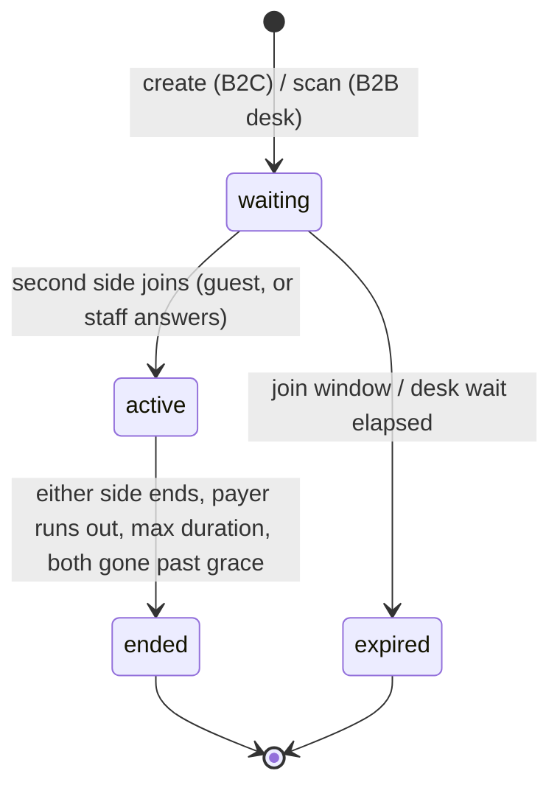

# Live Connect

Two phones, two microphones, two independent translation streams at the same time.
Decisions and requirements: [`specs/0121-live-connect/spec.md`](../specs/0121-live-connect/spec.md).

> **Status:** M1 (foundation) and M2 (backend: sessions REST, `/ws/live`, sweeper) are implemented.
> Everything marked *(planned)* below is specified but not built yet; this document is updated in
> the same change as the code it describes. Billing is still the *existing* per-tick meter charged to
> the owner; the idempotent per-peer meter is M5, so the feature must stay behind
> `LIVE_CONNECT_ENABLED=0` until M5 lands.

## How it fits together

```
phone A ──PCM16 24 kHz──▶ ┐                              ┌─▶ translated audio ──▶ phone B
                          │   /ws/live                   │
phone B ──PCM16 24 kHz──▶ ┤   one private room           ├─▶ translated audio ──▶ phone A
                          │   live-<session uuid>        │
                          └─▶ engine: one upstream session per speaker per target language
                              (Standard/Qwen by default; capacity fallback as in meetings)
```

No WebRTC. Each phone sends only its own microphone and receives only the **other** side's
translation. Rooms, engines, the usage meter, speech events and the org ledger are the existing
meeting machinery; Live Connect adds sessions, credentials and a payer who is not on the call.

## Session lifecycle



- B2C: the owner is the `host`; the invited person is the `guest`.
- B2B desk: the customer who scanned is the `guest`; the member of staff who answers is `staff`.
- A session holds at most **two** participants, one per side. The database enforces it
  (`live_participants` partial unique indexes), not only the application.

## Credentials *(implemented: `server/src/live/tokens.rs`)*

| Credential | What it is | Stored | Lifetime |
|---|---|---|---|
| Invite code | 192 random bits in a B2C link/QR | SHA-256 only (`live_sessions.invite_hash`) | join window |
| Guest token | signed claim: session, participant, role | hash only (`live_participants.token_hash`) | session life, so a phone can reconnect |
| Desk QR token | `HMAC(desk key, desk id ‖ version)`, 128 bits, printed in the QR | **nothing**; only `live_desks.token_version` | until revoked/regenerated |

- All three derive from one master secret `LIVE_TOKEN_KEY` through per-purpose labels. A signature
  for one purpose is worthless for another.
- The account JWT verifier cannot accept a guest token and the guest verifier cannot accept an
  account JWT, even if `LIVE_TOKEN_KEY` equals `JWT_SECRET` (covered by a test).
- A desk QR encodes `https://<app>/lc/d/<public_id>.<mac>`. No organisation, project or account
  identifier is derivable from it, and it never denotes an existing conversation: **every scan
  creates a new session**.
- Rotating `LIVE_TOKEN_KEY` invalidates every printed desk QR and every guest token in flight.

## Data model *(implemented: migration `065_live_connect.sql`)*

| Table | Purpose |
|---|---|
| `live_desks` | permanent QR entry points: org, optional project, name/location, default language, public handle, `token_version`, status |
| `live_sessions` | lifecycle, ownership (user **or** org), project and desk binding, expiry, `save_transcript`, link to `call_sessions` |
| `live_participants` | who is on the call; `peer_id` is the room peer id, server-minted |
| `live_usage_ticks` | one row per (session, peer, tick): the idempotency ledger for billing |
| `live_session_events` | bounded diagnostics (join, leave, reconnect, error, capacity, echo, exhausted) |

The conversation itself uses the existing `call_sessions` (`kind = 'live_connect'`),
`session_participants`, `transcript_events`, `transcripts` and `transcript_embeddings`.
`live_sessions.call_session_id` is `ON DELETE SET NULL`, so purging a conversation never erases the
billing record. All tables are RLS default-deny; tenancy is enforced in Rust like everywhere else.

## Configuration *(implemented: `server/src/live/config.rs`)*

See the Live Connect block in `server/.env.example`. The feature is off unless
`LIVE_CONNECT_ENABLED` is truthy **and** `LIVE_TOKEN_KEY` (≥ 32 chars) is valid; a bad key is an
error, never a fallback.

## API

| Route | Who | Status |
|---|---|---|
| `POST /api/live/sessions` | signed-in owner (B2C), or org member with `org_id` + `project_id` (B2B) | implemented |
| `POST /api/live/join` | anyone with an invite code (no account) | implemented |
| `GET /api/live/sessions/{id}`, `POST …/end` | a participant, with its Live Connect token (`Authorization: Bearer`) | implemented |
| `GET /ws/live?token=…` | a participant | implemented |
| `POST /api/live/desks/scan` | anyone with a desk QR | planned (M6) |
| `GET /api/live/desks/{id}/waiting`, `POST /api/live/sessions/{id}/answer` | org members | planned (M6) |
| `…/organizations/{org}/live/desks…`, `…/live/sessions…`, `…/live/usage` | org admin/member | planned (M6) |
| `/api/admin/live/*` | Directus flows | planned (M7) |

Errors are `{"code","message"}` with a stable code: `invite_not_found`, `invite_expired`,
`session_full`, `session_ended`, `consent_required`, `bad_lang`, `too_many_sessions`,
`insufficient_balance`, `insufficient_credits`, `subscription_required`, `project_required`,
`project_not_found`, `live_busy`, `rate_limited`.

### Rules the code enforces

- Creating needs an account that can pay. A business session also needs a project of **that** org
  (a foreign or archived project answers like a missing one), an active subscription and credit.
- Joining needs consent, a real language (never `auto`) and a well-formed code; a malformed and an
  unknown code answer identically. The guest seat is taken **once**; a second device is refused
  (`session_full`) and the first reconnects with its token.
- An owner holds at most `LIVE_MAX_CONCURRENT_PER_OWNER` open sessions; creates are serialised with
  an advisory lock so a burst cannot beat the cap.
- `live_busy` (503) is returned at create/join when the default engine has fewer than two free
  upstream sessions: Standard never reports `AtCapacity`, it silently skips a direction.

### `/ws/live`

- The token is checked **before** the upgrade (bad, expired, ended-session → 401/410, no socket).
- Identity comes from the database (peer id, name, language), never from the client. The room is
  `live-<session uuid>`, private, and unguessable.
- Client → server: `start`, `stop`, `mute_audio{muted}` and binary PCM16 mono 24 kHz frames.
  Mute is **enforced server-side**: a muted phone sends nothing to the engine.
- Server → client: the existing meeting frames (`room_joined`, `peer_joined`, `peer_left`,
  `subtitle_*`, `translated_audio`, `peer_muted`, `balance_*`, `capture_format`) plus
  `session_state{status, reason}` before the socket closes, and `error{code}`:
  `insufficient_balance`, `insufficient_credits`, `live_busy`, `engine_unavailable`,
  `audio_session_closed`, `billing_unavailable`.
- Hardening copied from `/ws`: connection cap, per-IP connect limit, frame and message-rate caps,
  ping every 15 s, close after 45 s of silence, slow-consumer drop. A momentarily slow engine drops
  a 100 ms chunk instead of ending the session.
- Each phone re-checks the session every 3 s, so an end by the other phone, the sweeper, an admin or
  the hard ceiling reaches it with the reason.
- Persistence follows policy: a business session always has its `call_sessions` row
  (`kind='live_connect'`, org and project set); a consumer one only when the owner opted in to saving.
  A room's session id is minted when the room is created, so a conversation that survives both phones
  dropping spans more than one; each is recorded as a `room_session` event.

### Sweeper

Every 15 s: expire invitations nobody used, close sessions past the ceiling, and end an **active**
session whose room has been empty for the whole reconnect grace (`abandoned`). It reads presence from
this process's room registry, which is correct because the server is a single replica.

## Billing *(planned: M5)*

The owner pays for **both** directions: a user's personal balance (B2C) or the org wallet (B2B).
The guest is never charged and needs no credit. A debit and its `live_usage_ticks` row commit
together with `ON CONFLICT DO NOTHING`, so a restarted or duplicated meter cannot charge twice.
The backend is the only authority; nothing the client reports is trusted.

## Privacy and retention *(planned: M4)*

- Raw audio is never stored.
- B2C conversations store nothing unless the owner opts in.
- B2B conversations are stored under the org's retention and the guest is told before the
  microphone opens. An org admin can delete a whole session, including guest speech.

## Operations

- Rooms are in memory and the server runs as a single replica: a deploy drops live sessions;
  phones reconnect within `LIVE_RECONNECT_GRACE_SECS`.
- Capacity: the Standard engine is capped at 32 upstream sessions per process, ≈ 16 simultaneous
  pairs. Beyond that a direction can go silent unless the capacity gate refuses new sessions first.

### Troubleshooting *(grows with each milestone)*

| Symptom | Check |
|---|---|
| Feature unreachable | `LIVE_CONNECT_ENABLED` truthy and `LIVE_TOKEN_KEY` ≥ 32 chars; the server logs why it stayed off |
| Every printed desk QR stopped working | was `LIVE_TOKEN_KEY` rotated? was the desk regenerated or revoked? |
| DB-gated tests "pass" in milliseconds | they skipped: the database is missing or lacks pgvector — use `docker compose up -d --wait postgres` and `voxtranslate_voip_test` |
